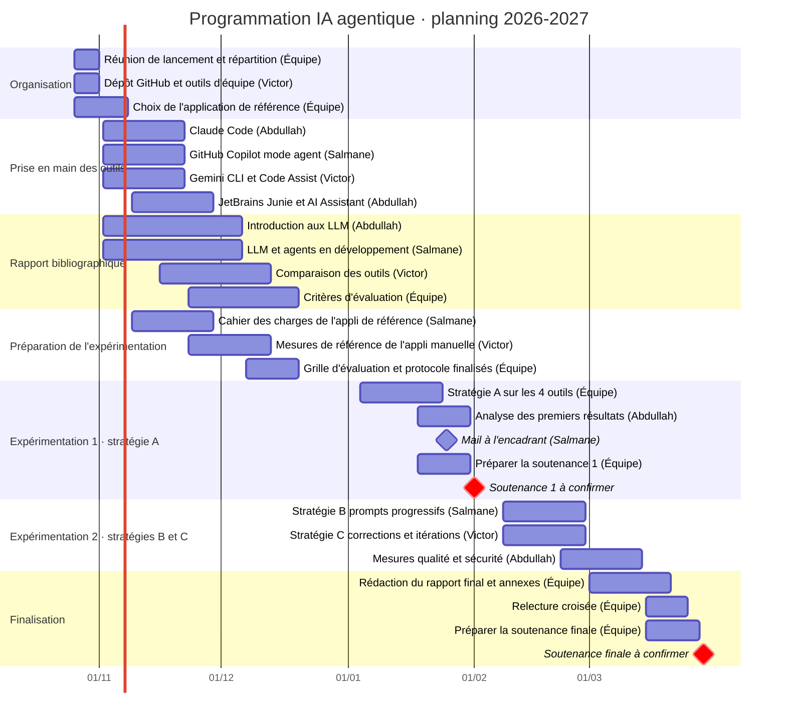

# Planning du projet

Diagramme de Gantt du projet, d'octobre 2026 à fin mars 2027. Les dates des soutenances sont à confirmer avec l'encadrant.

## Mettre à jour l'avancement

Dans le bloc ci-dessus, ajoutez un mot-clé juste après les deux-points de la tâche :

| Statut | Exemple |
|---|---|
| En cours | `Claude Code (Abdullah) :active, out1, 2026-11-02, 2026-11-22` |
| Terminée | `Claude Code (Abdullah) :done, out1, 2026-11-02, 2026-11-22` |
| Prioritaire / urgente | `... :crit, out1, ...` (combinable : `:crit, active, out1, ...`) |

Pour décaler une tâche, changez simplement ses dates. Le diagramme se met à jour dès que le fichier est enregistré sur GitHub.

## Suivi au quotidien

Le planning interactif partagé (statuts cliquables, filtre par personne, tâches en retard) reste disponible dans l'artefact Claude « Gantt IA Agentique », partagé par Abdullah. Ce fichier en est la version de référence dans le dépôt.
